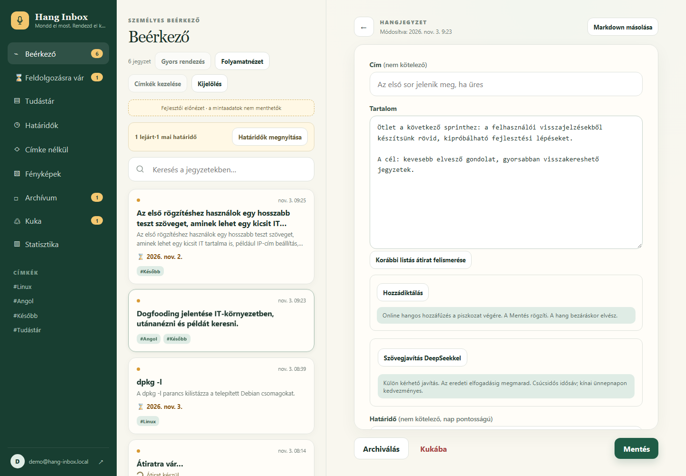
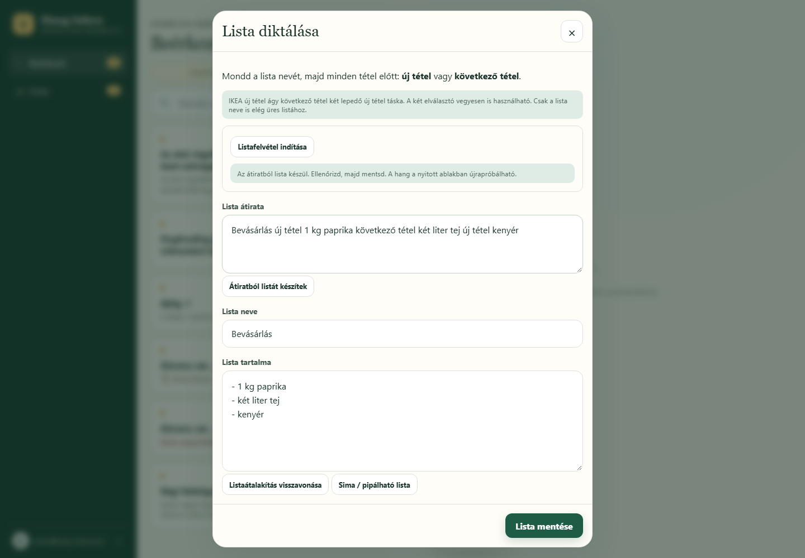
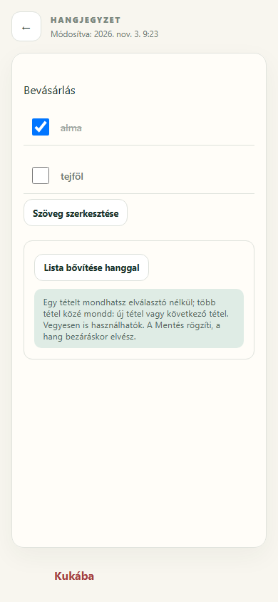
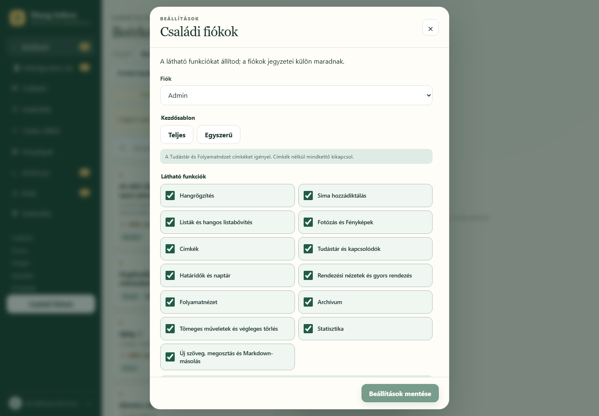

# Hang Mindenes · Hang Inbox

### Mondd el most. Rendezd el később.

Egy ötlet útközben, egy bevásárlólista, egy későbbre elmentett technikai jegyzet — gyakran pont akkor jut eszünkbe, amikor kényelmetlen gépelni. A Hang Inbox magyar nyelvű hangból szerkeszthető, kereshető jegyzetet készít, amelyet később listává, rendszerezett tudásanyaggá vagy határidős emlékeztetővé alakíthatunk.

**Mobilra tervezett, kezdőképernyőre telepíthető webalkalmazás, asztali munkához is illeszkedő felülettel.** Ez a repó a működő fejlesztési változat rövid portfólió-bemutatója, négy képernyőképpel.

## Mit lehet vele megoldani?

- **Gondolatok gyors rögzítése:** magyar hangátírás, szöveges jegyzet és meglévő jegyzet hozzádiktálása.
- **Bevásárlólista gépelés nélkül:** külön listamód, pipálható tételek, hangos bővítés és visszavonható átalakítás.
- **Visszakereshető személyes tudástár:** címkék, ékezetfüggetlen keresés, kapcsolódó jegyzetek, határidőnaptár és rendezhető folyamatnézet.
- **Személyre szabható használat:** Teljes és Egyszerű felület; az admin a látható funkciókat állítja, a fiókok jegyzetei külön maradnak.
- **Tudatos AI-használat:** a DeepSeek szövegjavítása külön kérhető javaslat. Az eredeti szöveg elfogadásig megmarad, a mentés külön döntés.

## Egy apró használati probléma, fontos tervezési döntés

A szabad diktálásból automatikusan kitalálni, hol kezdődik egy listaelem, bizonytalan lehet. Ezért a normál diktálás mellé **külön listamód** került, két egyértelmű, vegyesen is használható elválasztóval:

> „Bevásárlás **új tétel** 1 kg paprika **következő tétel** két liter tej **új tétel** kenyér”

Eredmény: **Bevásárlás** cím és három tétel. Az „1 kg paprika” egyben marad. A darabolás helyben történik, további AI-hívás nélkül. Üres és egytételes lista is készíthető; a sima és pipálható forma oda-vissza alakítható.

<strong>További képek: listakészítés, mobilhasználat és családi beállítások</strong>

### Átiratból ellenőrizhető lista

A cím, az átirat és a tételek mentés előtt javíthatók.

### Pipálható lista mobilon

A meglévő lista hanggal bővíthető, a korábbi pipák megtartásával.

### A felület alkalmazkodik a használóhoz

A funkciókapcsolókkal egyszerűbb felület is összeállítható; a beállítások tudatos mentéssel változnak.

## Technikai háttér — és miért számít

| Terület | Megoldás | Használati érték |
| --- | --- | --- |
| Felület és szerver | Svelte 5, SvelteKit 2, TypeScript, Vite | Egy alkalmazás mobilra és asztalra, ellenőrzött adatkezeléssel. |
| Telepíthetőség és helyi tárolás | PWA, MediaRecorder, IndexedDB | Gyors hangrögzítés; a normál hangjegyzet várólistája hálózati hibánál megőrzi az újrapróbálható felvételt. |
| Adatok és belépés | Supabase Auth, PostgreSQL, Row Level Security, privát képtárolás | A hozzáférés az adatbázisban is a jegyzet tulajdonosához kötött. |
| Beszédfelismerés | Groq API, Whisper | Magyar hangból szerkeszthető átirat. |
| Szövegjavítás | Szerveroldali DeepSeek API | Opcionális javaslat, szerveren maradó titkos kulccsal; a működéshez nem kell ChatGPT-előfizetés. |
| Futtatás és ellenőrzés | Vercel Preview; Vitest, PGlite, Playwright | Kipróbálható fejlesztési változatok, logikai, SQL-jogosultsági és böngészős próbák. |

**A megbízhatóság a használati folyamat része:** visszavonható piszkozatok, verzióellenőrzéses mentés a párhuzamos módosítások védelmére, tulajdonoshoz kötött helyi hangvárólista és hibánál újrapróbálás. A listadiktálás és a nyitott jegyzet hangos bővítése online folyamat; ezek hangja a nyitott ablakban próbálható újra.

## Eredmények és jelenlegi állapot

- A legutóbbi teljes helyi ellenőrzésben **313 unit/SQL teszt és 362 böngészős teszteset sikeres**; 16 dokumentált eset kihagyva. Asztali Chromium, emulált Android Chromium és mobil WebKit szerepel a tesztmátrixban.
- Használói visszajelzés igazolja a vegyes listaelválasztók működését és az „1 kg paprika” egy tételben tartását.
- A DeepSeek szerveroldali kapcsolatpróbája sikeres; a valódi szövegjavítás minőségének értékelése és a fizikai mobil/PWA próbák egy része még hátravan.

A projekt **aktív fejlesztési és kipróbálási állapotban** van. A fenti teszteredmény a 2026. október 29-i forrásállapothoz tartozik; nem éles üzemi rendelkezésre állási vagy beszédfelismerési pontossági mérés.

**Fejlesztési fókusz:** egy hétköznapi problémából végigvitt webes megoldás — felülettervezés, backend, adatvédelem, AI-integráció és automatizált tesztelés. A listamód jó példája annak, hogyan lesz a használói visszajelzésből egyszerűbb és kiszámíthatóbb működés.

---

Bemutató frissítve: **2026. november 3.** A képek a jelenlegi fejlesztési változatból, mintaadatokkal készültek; a mobilkép emulált nézet. A repó bemutatóanyagokat tartalmaz, az alkalmazás forráskódja és üzemeltetési adatai külön maradnak. [Frissítési jegyzet](MAINTENANCE.md)
